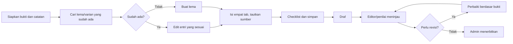

# Panduan Mahasiswa: Membuat dan Mengedit Entri Kamus Tolaki

**Sasaran:** mahasiswa pengumpul data. **Versi:** 1.0 — 17 Oktober 2026.  
**Cakupan:** backoffice **Kamus → Lema dan Makna**, pengumpulan bukti, create/edit, dan dasar penilaian.

> Panduan ini menjelaskan tata cara input; bukan penetapan bentuk Tolaki yang belum disahkan. Ikuti protokol kelas/dosen/editor bila lebih khusus.

## 1. Tujuan dan prinsip

Mahasiswa diharapkan dapat membedakan lema dan makna, memasukkan padanan menurut makna, menautkan contoh dan sumber, menjaga etika data, serta menindaklanjuti review.

- **Jangan mengarang.** Jangan menebak definisi, padanan, wilayah, contoh, transkripsi, sumber, atau izin. Field opsional boleh kosong.
- **Satu lema, banyak makna; satu makna, banyak padanan.**
- **Pertahankan bentuk sumber.** Jangan menghapus apostrof, vokal rangkap, tanda hubung, atau mengubah ejaan tanpa keputusan editor.
- **Catat bukti dan ketidakpastian.** Hindari data pribadi/sensitif dalam field kamus.
- Data mahasiswa adalah **draf** sampai ditinjau; admin berwenang menerbitkan.

## 2. Alur kerja

Sebelum input, siapkan bentuk Tolaki dari sumber, konteks makna, padanan yang diperiksa, contoh dan terjemahannya, sitasi/kode sumber sesuai protokol, metode pengumpulan, wilayah jika diketahui, serta izin kutipan/audio.

## 3. Peta form

| Tab | Isi | Catatan |
|---|---|---|
| **1. Identitas** | Lema, profil ortografi, bentuk/varian, analisis morfologi | Lema wajib; sisanya sesuai bukti |
| **2. Makna & padanan** | Makna, kelas kata, definisi, padanan, contoh, relasi | Minimal satu makna; contoh/relasi berada di dalam makna |
| **3. Pelafalan** | Transkripsi, sistem, wilayah, audio dan hak | Opsional; audio perlu izin |
| **4. Editorial** | Status, reviewer, ID lama | Baca saja; tidak diisi mahasiswa |

Tombol **Tambah ...** membuat item repeater. Buka item yang terlipat untuk memeriksa isinya. Pada layar kecil, form dapat menjadi satu kolom.

## 4. Petunjuk per tab

### 1 — Identitas

**Lema / headword Tolaki (wajib):** satu kata dasar (headword) saja; jangan masukkan kelas kata, definisi, terjemahan, atau beberapa kata dipisahkan koma. Cari entri/varian mirip dahulu agar tidak membuat duplikat. Jika ragu lema baru atau varian, tanyakan editor.

**Profil ortografi:** pilih profil sesuai arahan editor. Profil historis/kandidat bukan otomatis standar modern. Jangan menebak bila statusnya tidak jelas.

**Bentuk lain dan varian:** satu bentuk per item. Pilih jenis yang sesuai (varian ejaan/pelafalan, turunan, subentri, historis); isi wilayah hanya berdasarkan bukti; kaitkan sumber pendukung; gunakan catatan untuk menjelaskan perbedaan. Jangan ulangi headword sebagai varian tanpa alasan.

**Analisis morfologi (opsional):** isi hanya bila segmentasi dan lema dasar dapat dipertanggungjawabkan. Ikuti konvensi kelas/editor. Biarkan status **Belum ditinjau** kecuali dosen memberi kewenangan. Jangan memenggal kata berdasarkan intuisi ejaan.

### 2 — Makna & padanan

Tekan **Tambah makna** untuk tiap makna yang berbeda berdasarkan bukti/konteks. Nomor harus positif, unik, dan berurutan.

| Field | Pedoman |
|---|---|
| Kelas kata | Pilih nomina, verba, adjektiva, adverbia, pronomina, preposisi, konjungsi, interjeksi, atau frasa/ungkapan; tanyakan editor jika ragu |
| Kategori/domain | Pilih bila relevan; ini bukan pengganti definisi |
| Definisi utama Indonesia | Jelas, ringkas, membedakan makna; hindari definisi melingkar atau hanya mengulang lema |
| Definisi Tolaki/Inggris | Opsional; isi hanya setelah diperiksa penutur/editor |
| Catatan penggunaan | Ragam, situasi, konstruksi, atau batasan penggunaan |
| Catatan budaya | Informasi relevan, kontekstual, bersumber, tidak menggeneralisasi komunitas |
| Sumber | Pilih bukti yang memang mendukung makna tersebut |

Definisi yang baik menyebut kategori semantik lalu ciri pembeda. Bedakan definisi dari catatan ensiklopedis.

**Padanan:** setiap item mewakili satu padanan dalam satu bahasa dan satu makna. Pilih bahasa Indonesia/Inggris, isi kata/frasa, lalu jenis:
- **Padanan langsung:** kesepadanan dekat;
- **Glos:** penjelas ringkas;
- **Deskriptif:** frasa penjelas;
- **Bergantung konteks:** pilihan berubah sesuai konteks.

Tambahkan konteks dan sumber bila diperlukan. Jangan menyatukan padanan berbeda konteks dalam satu field. Jika belum diketahui, jangan membuat placeholder; aplikasi menampilkan **Belum tersedia**.

**Contoh penggunaan:** harus berupa kalimat Tolaki yang mendukung makna tersebut, bukan karangan untuk memenuhi jumlah. Tambahkan terjemahan Indonesia/Inggris yang telah diperiksa. Pilih metode **Pemakaian yang tercatat**, **Elisitasi**, **Data lama yang diimpor**, atau **Belum diketahui** sesuai asalnya. Catat wilayah/metode/sumber hanya sejauh diketahui. Jangan tulis identitas pribadi informan.

**Relasi makna:** pilih sinonim, antonim, lihat juga, atau berkaitan berdasarkan alasan yang jelas. Field **Makna terkait** wajib dipilih. Jika target belum ada, catat usulan kepada editor; jangan membuat relasi kosong.

### 3 — Pelafalan

Opsional. Catat transkripsi dan sistemnya; jangan campur transkripsi fonetis/fonemis tanpa label. Wilayah harus berbukti. Audio maksimal **5 MB**; format yang diterima MP3, WAV, OGG, WEBM, MP4 audio. Jangan unggah suara tanpa persetujuan. Pilih **Belum diketahui** untuk status hak bila izin belum jelas; jangan menyatakan izin/domain publik tanpa bukti.

### 4 — Editorial

Status, reviewer, dan ID lama adalah baca-saja. Sistem membuat draf; editor/penilai meninjau dan admin menerbitkan. Jangan mengubah status manual.

## 5. Membuat dan mengedit

### Persiapan akses oleh admin/dosen

Saat panduan ini ditulis, aplikasi belum memiliki peran khusus **mahasiswa/pengumpul data**. Hak create diberikan kepada peran `editor`, sedangkan peran itu juga dapat melihat tindakan editorial seperti menandai entri ditinjau. Sebelum dipakai untuk penilaian kelas, admin perlu memastikan mahasiswa hanya dapat membuat dan mengedit entri miliknya tanpa memperoleh kewenangan review/publikasi. Jika pemisahan hak belum diterapkan, gunakan prosedur kelas yang diawasi dan jangan membagikan akun reviewer/admin. Log penilaian pada panduan ini juga merupakan log kelas terpisah; belum menjadi fitur pencatatan aktivitas mahasiswa otomatis di aplikasi.

1. Masuk dengan akun/hak akses dari admin/dosen.
2. Buka **Kamus → Lema dan Makna**, cari lema dan variasinya.
3. Jika belum ada pilih **Buat lema**; jika sudah ada jangan buat duplikat. Edit entri yang ada hanya jika diizinkan.
4. Isi Identitas dan Makna & padanan; pastikan contoh/relasi berada di makna yang tepat.
5. Isi Pelafalan hanya bila bukti dan izin cukup.
6. Periksa checklist di bawah, lalu simpan. Status awal adalah **draft**.
7. Catat ID/tautan lema dalam log kelas. Saat mengedit, pertahankan data yang benar; tanggapi komentar reviewer dengan bukti dan catat perubahan.
8. Jika tombol Edit tidak tersedia, hubungi editor/admin; jangan membuat salinan.

## 6. Checklist sebelum simpan

- [ ] Saya sudah mencari lema/varian serupa.
- [ ] Headword satu bentuk Tolaki; ejaan sumber dipertahankan.
- [ ] Varian, wilayah, dan morfologi tidak ditebak.
- [ ] Makna berbeda, nomor unik, kelas kata sesuai bukti.
- [ ] Definisi Indonesia jelas; definisi Tolaki/Inggris telah diperiksa.
- [ ] Padanan berada pada makna/bahasa yang benar dan konteks dicatat bila perlu.
- [ ] Contoh autentik/tertelusur, sesuai makna, terjemahan diperiksa.
- [ ] Relasi punya target yang benar.
- [ ] Sumber/metode tercatat; tidak ada data pribadi tidak berizin.
- [ ] Audio dan haknya sesuai persetujuan.
- [ ] Status editorial dibiarkan dikelola sistem.

## 7. Kesalahan umum

| Kesalahan | Perbaikan |
|---|---|
| Beberapa kata dimasukkan ke satu headword | Satu headword; varian dicatat sebagai item terhubung |
| Definisi mengulang padanan | Beri kategori semantik dan ciri pembeda |
| Semua arti digabung | Pisahkan makna berdasarkan bukti |
| Contoh salah ditempatkan | Kaitkan contoh pada makna yang benar |
| Wilayah/ejaan ditebak | Kosongkan dan tanyakan editor |
| Relasi tanpa target | Pilih target yang ada atau catat usulan |
| Hak audio diasumsikan | Gunakan belum diketahui sampai ada bukti |

## 8. Rubrik aktivitas input — usulan untuk dosen

Tetapkan rubrik/bobot sebelum kegiatan dimulai. Banyaknya entri saja bukan ukuran utama.

| Dimensi | Bobot | Bukti penilaian |
|---|---:|---|
| Identitas lema dan ortografi | 15 | Pencarian duplikasi, lema tepat, varian terpisah |
| Analisis makna dan kelas kata | 20 | Makna dibedakan dengan alasan, label sesuai bukti |
| Definisi dan padanan | 20 | Definisi Indonesia jelas; padanan ID/EN akurat/kontekstual |
| Contoh dan terjemahan | 15 | Contoh tertelusur, terkait makna, terjemahan diperiksa |
| Sumber, bukti, etika, privasi | 15 | Sumber/metode sesuai; wilayah tidak ditebak; audio aman |
| Proses dan revisi | 10 | Draf benar; komentar ditanggapi; perubahan dijelaskan |
| Kerapian pencatatan | 5 | Tidak ada duplikasi/kesalahan tempat |
| **Total** | **100** | |

| Capaian | Deskriptor |
|---|---|
| **4 — Sangat baik** | Bukti kuat; analisis konsisten; ketidakpastian diakui; revisi tuntas |
| **3 — Baik** | Umumnya tepat; kekurangan kecil tidak mengubah makna inti |
| **2 — Perlu perbaikan** | Beberapa bagian kurang bukti/konteks atau belum konsisten |
| **1 — Belum memenuhi** | Banyak dugaan tanpa sumber, makna tercampur, data salah tempat, atau masalah etika |

Dosen dapat memberi skor 1–4 per dimensi dan mengonversikannya menurut bobot. Tetapkan juga target jumlah, kerja kelompok, dan perlakuan terhadap entri yang menunggu verifikasi. Jangan menghukum mahasiswa karena padanan/audio belum tersedia jika keterbatasannya dicatat jujur dan prosedur dipatuhi.

**Log kerja yang disarankan:** mahasiswa/kode kelompok; ID/tautan lema; jenis aktivitas; tanggal; kode bukti yang aman; ringkasan keputusan; komentar reviewer dan tindak lanjut. Jangan masukkan data sensitif.

## 9. Rujukan

- [Keputusan ortografi](keputusan-ortografi.md) — masih draf; rujukan historis 1985 belum otomatis menjadi standar modern.
- [Kamus data](data-dictionary.md).
- [Rencana implementasi](../RENCANA-IMPLEMENTASI-KAMUS.md).
- Form aktif: `app/Filament/Resources/DictionaryEntries/Schemas/DictionaryEntryForm.php`.

Jika UI berubah, laporkan agar panduan diperbarui. Panduan ini tidak menggantikan protokol etik/lapangan atau adjudikasi editor/penutur.

